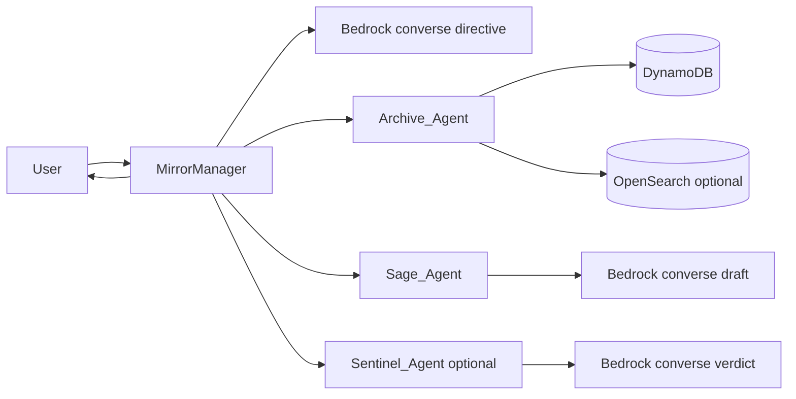

# Mirror Agent Architecture

## Overview

Mirror Agent is a Lambda-based orchestration system centered on `MirrorManager`. It supports direct chat/history APIs and an asynchronous WATI webhook path.

Core runtime units:

- `MirrorManager`
- `Archive_Agent`
- `Sage_Agent`
- `Sentinel_Agent`
- `MirrorManager-WatiWorker`

## Core Flow



## Async WATI Flow

```mermaid
flowchart LR
    WATI --> ApiGw[/Wati-message]
    ApiGw --> MMQ[MirrorManager queue step]
    MMQ --> SQS[(SQS queue)]
    SQS --> WW[WatiWorker]
    WW --> MM2[MirrorManager async invoke]
```

## Session Rules

- Session marker key: `SessionId=<id>`, `Timestamp="SESSION"`.
- Missing/blank session IDs are minted (UUID v4), except WATI conversation mapping.
- Unknown provided session IDs are replaced with new UUIDs.
- `/history` does not mint sessions; it returns `404` for unknown IDs.

## Sage/Sentinel Retry Loop

- `max_sage_retries` controls retries.
- Total drafts attempted = `max_sage_retries + 1`.
- Rejected sentinel verdicts pass `rejection_feedback` into next Sage attempt.
- If no safe draft is approved, final reply falls back to `"Unable to produce a safe reply."`

## Config and Prompt Precedence

Shared helper behavior from `agents/config_runtime.py`:

- Agent config: defaults -> unified `agents/config/agent_runtime.properties` (`<agent_key>.*`)
- Prompt text: `<agent_key>.prompt_file` -> `agents/config/prompts/*.txt` -> hardcoded fallback

Sage adds live DynamoDB overrides:

- Table selected from `TABLE_CONFIG` or merged config `table_config`
- Row key: `AgentRole = "Sage"`
- Supported fields: `ModelId`, `SystemPromptTemplate`, `Temperature`, `MaxTokens`
