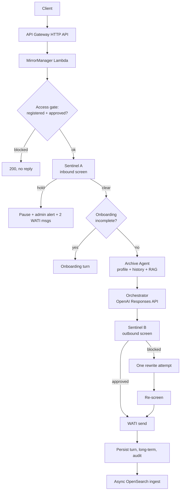
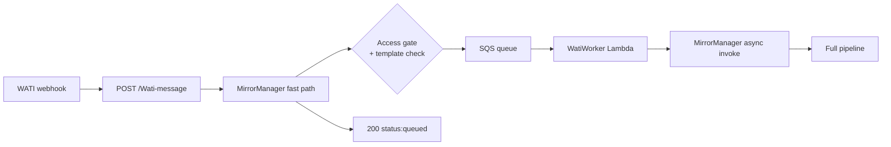

# Mirror — Codebase Reference & Code Review

> Single source of truth for how this repository works. Written for an AI coding agent or a new engineer who needs full context before touching anything.
>
> Verified against the working tree by direct file reading. Line numbers are accurate as of writing; treat them as strong hints, not guarantees, after future edits.

---

## Table of contents

1. [What Mirror is](#1-what-mirror-is)
2. [Repository layout & git scope](#2-repository-layout--git-scope)
3. [System architecture](#3-system-architecture)
4. [Python backend — `agents/`](#4-python-backend--agents)
   - 4.1 [File inventory](#41-file-inventory)
   - 4.2 [`lambda_handler` route table](#42-lambda_handler-route-table)
   - 4.3 [The message pipeline, stage by stage](#43-the-message-pipeline-stage-by-stage)
   - 4.4 [Helper function map](#44-helper-function-map)
   - 4.5 [Sibling Lambda contracts](#45-sibling-lambda-contracts)
   - 4.6 [Safety subsystem: Sentinel, holds, pause ladder](#46-safety-subsystem-sentinel-holds-pause-ladder)
   - 4.7 [Onboarding](#47-onboarding)
   - 4.8 [B2B / Domain 9](#48-b2b--domain-9)
   - 4.9 [Analytics](#49-analytics)
5. [Data model — DynamoDB](#5-data-model--dynamodb)
6. [Configuration & environment variables](#6-configuration--environment-variables)
7. [Error handling, timeouts, and fail-open/fail-closed policy](#7-error-handling-timeouts-and-fail-openfail-closed-policy)
8. [Web app — `genmyo-web/`](#8-web-app--genmyo-web)
   - 8.1 [Stack & tooling](#81-stack--tooling)
   - 8.2 [Directory map](#82-directory-map)
   - 8.3 [API routes (BFF)](#83-api-routes-bff)
   - 8.4 [Pages & role gating](#84-pages--role-gating)
   - 8.5 [Components](#85-components)
   - 8.6 [Auth (or the absence of it)](#86-auth-or-the-absence-of-it)
   - 8.7 [The automation subsystem](#87-the-automation-subsystem)
9. [Tests](#9-tests)
10. [Deployment & infrastructure](#10-deployment--infrastructure)
11. [Code review — findings](#11-code-review--findings)
12. [Conventions for agents working in this repo](#12-conventions-for-agents-working-in-this-repo)
13. [Common tasks — where to look](#13-common-tasks--where-to-look)

---

## 1. What Mirror is

Mirror is a WhatsApp-delivered AI companion for emotional/psychological reflection, operated by GenMyō. Users message a WhatsApp business number; a chain of AWS Lambda "agents" retrieves their profile and history, generates a reply through an LLM, screens it for safety, and delivers it back through WATI (a WhatsApp Business API provider).

Two deliverables live in this repo:

- **`agents/`** — Python 3 AWS Lambda backend. One fat orchestrator Lambda (`MirrorManager`) plus five sibling Lambdas, fronted by API Gateway HTTP API, backed by DynamoDB and optionally OpenSearch.
- **`genmyo-web/`** — Next.js 15 App Router application serving a marketing page, three consumer portals (member / employee / employer), and an admin console. It is a **BFF**: the browser never talks to AWS directly; Next route handlers proxy to API Gateway.

Two distinguishing characteristics shape almost every design decision:

1. **Safety is adversarial to latency.** Every outbound message passes a "Sentinel" screen. Inbound distress signals can halt the conversation entirely and page a human. Timeouts are aggressive (3–6 seconds per agent) because WhatsApp users expect near-realtime replies.
2. **Delivery is the commit point.** The pipeline sends the WhatsApp message *before* persisting the turn. A failed send releases the idempotency claim so the message can be retried, rather than leaving a half-written conversation.

---

## 2. Repository layout & git scope

```
d:\GenMyo Main\Mirror\
├── agents/              Python Lambda backend (TRACKED)
├── genmyo-web/          Next.js portal (TRACKED)
├── tests/               pytest suite, 210 tests / 30 files (TRACKED)
├── admin_app.py         Legacy FastAPI single-row config editor (TRACKED, superseded)
├── run_local_test.py    moto-based local smoke harness (TRACKED)
├── requirements.txt     Unpinned: boto3, moto, pytest, fastapi, uvicorn
├── Readme.md            Operator manual (partially stale — see §11)
├── ARCHITECTURE.md      Mermaid flows + session/config contracts
├── security_audit.md    15-finding security review (partially stale)
└── CODEBASE.md          This file
```

### Critical: much of the system is deliberately not in git

`.gitignore` is a load-bearing security control, not housekeeping. Its header states the policy: *git tracks Python agent/runtime code + tests only.* Ignored and **physically absent from this working copy**:

| Ignored path | What it held | Consequence |
|---|---|---|
| `scripts/` | All deploy/ops PowerShell, IAM policy JSON, VPC and API Gateway metadata, account IDs | **No IaC exists anywhere.** The AWS topology is unversioned. |
| `agents/config/` | Live `agent_runtime.properties` + `prompts/*.txt` | Prompts and tuning are not code-reviewed. Only `.example` and `README.md` are tracked. |
| `docs/` | Specs, including `b2b_onboarding_spec_reconciled.md` | Referenced by both READMEs, unreadable here. |
| `wati-ui/` | Legacy admin UI | Superseded by `genmyo-web`. |
| `setup_env.sh` | Local bootstrap | Undiscoverable onboarding step. |

**Implication for an agent working here:** commands the READMEs tell you to run (`.\scripts\deploy.ps1`, `.\scripts\test_functions.ps1`, `scripts/deploy-prod.ps1`) do not exist on disk. Do not attempt them. Do not attempt to reconstruct them without asking, because they encode production account IDs and VPC identifiers that were purged from history on purpose.

---

## 3. System architecture

### Synchronous chat path (`POST /chat` — dev/test only)



### Asynchronous WhatsApp path (production)



The fast path exists because WATI expects a webhook ack within seconds. The gate runs **before** enqueueing, so unapproved users cost nothing downstream.

### Why one fat Lambda

`mirror_manager.py` is ~6,280 lines and handles 26 HTTP routes plus the entire pipeline plus all persistence. This is intentional (cold-start and IAM simplicity) but it is also the single largest source of risk in the repo. See [§11](#11-code-review--findings).

---

## 4. Python backend — `agents/`

### 4.1 File inventory

| File | Lines | Purpose |
|---|---|---|
| `mirror_manager.py` | 6282 | The orchestrator. HTTP router, pipeline, safety gates, all DynamoDB writes, WATI I/O, admin + B2B endpoints. |
| `archive_agent.py` | 324 | Context retrieval: `Agent_Profiles` + `Agent_Sessions` history + OpenSearch kNN RAG with optional LLM query-rewrite/rerank. |
| `sentinel_agent.py` | 192 | Dual-mode safety. Mode A screens inbound user text; Mode B screens the outbound draft. |
| `evaluator_agent.py` | 392 | Test-mode-only scorer. Compares actual vs desired output, emits an ordered `pipelineFlow` trace. |
| `wati_worker.py` | 75 | SQS consumer; replays queued webhooks into MirrorManager. Reports partial batch failures. |
| `onboarding_agent.py` | 213 | One onboarding conversation turn via OpenAI Responses API with a profile-update tool. |
| `onboarding_profile.py` | 282 | Pure logic: completion checks, step transitions, tool schema, backfill rules, write allowlist. |
| `openai_proxy_agent.py` | 208 | Egress proxy so VPC-bound Lambdas reach `api.openai.com`. Host-allowlisted. |
| `mirror_orchestrator_contract.py` | 175 | Input builder, JSON schema, parser, WhatsApp markdown normalizer for orchestrator output. |
| `config_runtime.py` | 141 | Loads `agents/config/agent_runtime.properties` by `<agent>.` prefix; strict prompt loading with mtime cache. |
| `opensearch_helper.py` | 255 | SigV4 OpenSearch client: index create, Titan embeddings, index docs, kNN search. |
| `analytics_events.py` | 255 | Idempotent event writer (conditional put on `EventId`) + event-type catalog. |
| `analytics_rollups.py` | 395 | Daily/user/directory rollup counters, cached snapshot reads. |
| `analytics_query.py` | 421 | Read side for admin dashboards. |
| `domain9.py` | 767 | B2B employer/seat/membership single-table store. |
| `consent_events.py` | 154 | Append-only consent records for B2B onboarding. |
| `genmyo_content_repository.py` | 211 | Content vector-store search with generation/wound filters + relaxation retry. |
| `archive_wound_summary.py` | 198 | Builds the "wound knowledge" prose block injected into the Archive profile. |
| `generation_from_dob.py` | 148 | Derives generation label (Gen Z / Millennial / …) from DOB. |
| `llm_providers/bedrock_provider.py` | 35 | `converse_text()` over Bedrock Converse. |
| `llm_providers/openai_provider.py` | 128 | `chat_text()` over Chat Completions, direct or via proxy Lambda. |
| `llm_providers/openai_responses_provider.py` | 342 | Responses API: structured outputs, `file_search`, custom tool-call loop. |
| `llm_providers/openai_vector_store_search.py` | 108 | Vector-store search endpoint wrapper. |
| `llm_providers/common.py` | 51 | `extract_bedrock_converse_text()` + shared parsing. |
| `llm_providers/http_retry.py` | 44 | Retry/backoff. Retries 5xx, not 4xx. |

**Dead or legacy — do not extend:**

| File | Status |
|---|---|
| `mirror_phase1.py` (574 lines) | The legacy "MF1" directive contract. Imported **only** by `tests/test_mirror_phase1.py`. `mirror_manager.py` no longer imports it. |
| `sage_agent.py` (151 lines) | Legacy reply drafter. Still deployable, resolved into a function name, but **never invoked** on the live path — the orchestrator replaced it. |
| `humanalyst_agent.py` (193 lines) | Legacy persona shaper. `humanalyst_enabled=false` by default and the flag is read then never used. |
| `generation_csv.py` (97 lines) | Offline CSV backfill; test-only. |

### 4.2 `lambda_handler` route table

`lambda_handler` begins at **line 4889**. Dispatch happens in three layers.

**Layer 1 — internal async jobs** (4893–4922). Triggered by a top-level `"job"` key, invoked via `_invoke_self_async` (871).

| Job | Lines | Behaviour |
|---|---|---|
| `weekly_summary` | 4896–4909 | `_generate_weekly_summary_from_history` (777) → writes `weekly_conversation_summary`. |
| `opensearch_ingest` | 4910–4922 | `_index_to_opensearch` (4800). |

Both return `200 {"ok": true}` **regardless of internal failure** — silent by design, so failures are only visible in CloudWatch.

**Layer 2 — non-API-Gateway replay** (4924–4932). Event with a dict `body` but no API Gateway shape is treated as a WATI replay. `_maybe_handle_wati_template_webhook` (1930) intercepts template-sent/failed events first.

**Layer 3 — HTTP routes** (4934–4968 matching, 4983–5382 handlers). Matching is `_apigw_path(...).rstrip("/").endswith(<suffix>)`, except employer routes which use regex (4943–4956). Handlers run as a **linear if-chain**, so route precedence is positional.

| Method + path | Line | Handler | Effect |
|---|---|---|---|
| `POST /users/disapprove` | 4983 | `_handle_users_disapprove` (3766) | Revokes directory approval. |
| `POST /employers/provision` | 4990 | `_handle_employers_provision` (3560) | Creates employer + seat pool + join code. |
| `GET /employers` | 4997 | `_handle_employers_list` (3495) | Employers with seat briefs. |
| `GET /employers/{id}` | 5004 | `_handle_employer_detail` (3506) | Metadata + seats. |
| `GET /employers/{id}/seats` | 5011 | `_handle_employers_seats` (3596) | Seat accounting. |
| `POST\|PATCH\|PUT /employers/{id}/seats` | 5018 | `_handle_employer_update_seats` (3528) | Adjust seat pool. |
| `GET /employers/{id}/members` | 5025 | `_handle_employer_members` (3517) | Memberships. |
| `POST /employers/{id}/cohorts` | 5034 | `_handle_employer_add_cohort` (3546) | Add cohort. |
| `POST /memberships/{exit,convert,dormant,reactivate,activate}` | 5041–5074 | `_handle_memberships_lifecycle` (3607) | Seat lifecycle. |
| `POST /users/approve` | 5076 | `_handle_users_approve` (3474) | Approve; may fire welcome template. |
| `POST /users/sentinel-clear` | 5083 | `_handle_users_sentinel_clear` (1587) | Manual pause clear. |
| `GET /users` | 5090 | `_list_registered_users` (3306) | Directory with generation labels. |
| `GET /holds` | 5098 | `_list_active_sentinel_holds` (3148) | Active holds inbox. |
| `POST /holds/clear` | 5106 | `_handle_holds_clear` (3209) | Clear hold record + pause. |
| `GET /holds/history` | 5113 | `_list_hold_history` (3116) | Requires `publicUid`; 400 otherwise. |
| `GET /analytics/summary` | 5127 | `analytics_query.get_analytics_summary` (210) | Aggregates. **Not registered on staging gateway.** |
| `GET /analytics/user` | 5135 | `analytics_query.get_user_analytics` (301) | Per-user. **Not registered on staging.** |
| `POST /admin/send` | 5155 | `_handle_admin_send_message` (4195) | WATI-only outbound, no memory write. Returns 502 on WATI failure. |
| `POST /Wati-message` | 5162, fast path 5394 | template check → enqueue | `{"status":"queued"}`. |
| `POST /register` | 5169 | inline 5169–5325 + `_upsert_user_directory` (3787), `_merge_profile_registration_fields` (3934), `_apply_b2b_seating_after_register` (3673) | Registration + optional B2B seat attach. |
| `POST /profile` | 5372 | `_update_profile_fields` (2167) | Whitelisted profile write. **Undocumented in any README.** |
| `GET /history` | 5495 | invokes Archive directly | `{sessionId, profile, history}`. 404 for unknown session. |
| `POST /chat` (fallthrough) | 5384→6282 | full pipeline | See §4.3. |

Pre-route behaviour: profile-only requests short-circuit at 5329–5346; `_extract_user_text_and_ids` (1863) normalizes `{from,text}`, `{userId,message}`, and raw WATI shapes at 5361 and 5384.

### 4.3 The message pipeline, stage by stage

| # | Stage | Function / line | Input | Output |
|---|---|---|---|---|
| 0 | Access gate | `_chat_access_block_reason` (2604), called 5410 & 5542 | `user_id`, config | `(block_reason, canonical_uid)`. Blocked → `_block_unapproved_chat` (3391) / `_block_unregistered_chat` (3370), both **200 with no outbound message**. |
| 1 | Session ensure | `_ensure_session` (2074), 5566 | `session_id`, `user_id` | Marker item, TTL 24h. |
| 2 | Idempotency claim | `_claim_wati_inbound` (905), 5570 | `whatsappMessageId` | `False` → `{"status":"duplicate_skipped"}`. |
| 3 | Pause gate | `_sentinel_pause_active` (1288) / `_block_sentinel_paused_chat` (1552), 5596–5610 | profile pause fields | Early 200 with the locked pause message. |
| 4 | **Sentinel A** | `_invoke_agent(..., agent_kind="sentinel_a")` **5634** | `{mode:"A", user_text, context:{archive_gen, archive_lotus_stage, archive_wound_signal}}` from `_sentinel_a_archive_context_hints` (2130) | `{hold, tier, distress_signals[], session_distress_tier}` |
| 4a | Hold branch | 5655–5852 | `hold=true` | Admin alert (4689) + pause activate (1359) + hold record (2941) + **two WATI messages 1s apart** (5751–5774), then returns early. |
| 5 | Onboarding gate | `_handle_onboarding_turn` (4599), 5881 | profile + text | `{sessionId, reply, onboarding:true}`, exits pipeline. |
| 6 | **Archive** | `_invoke_agent(..., agent_kind="archive")` **5920** | `{userId, sessionId, query}` | `{statusCode, body:{profile, history[], rag_context[], recent_history, top_rag, session_summary}}` |
| 6a | Profile refresh | `_load_profile_item` (4467), 5976 | userId | DynamoDB values override Archive's copy. |
| 7 | **Orchestrator** | `_mirror_orchestrated_reply` (963), **6026** | text, profile, weekly summary, `previous_response_id`, vector store id | `(reply_text, session_metadata, new_response_id)`. Tools: `historysearch` (731), `content_repository_search` (1028), `file_search`. |
| 8 | Weekly state persist | `_update_profile_internal_fields` (2207), 6054 | week key, summary, response id | Best-effort. |
| 9 | **Sentinel B** | `_sentinel_b_gate_with_single_rewrite` (228), **6103** | `{mode:"B", draft_reply, context}` incl. `session_distress_tier` + pause fields (1536) | `(final_text, verdict, "APPROVED"\|"BLOCKED")`. On block: one rewrite via `_mirror_rewrite_after_sentinel_block` (133), then re-check. |
| 10 | Text cleanup | `_clean_user_facing_text` (411), 6133 | draft | Strips preambles, role echo, JSON quoting. |
| 11 | Evaluator (test mode only) | `_invoke_agent` 6179 | full trace 6139–6165 | `{evaluationScore, breakdown, pipelineFlow, …}` |
| 12 | **WATI send** | `_wati_post_text_to_conversation` (4116), **6214** | conversationId, text, waId | `None` on success, error string on failure. |
| 13 | Persistence | `_append_turn_to_session` (3983), `_write_long_term_turns` (4020), `_write_audit_log` (4082), 6259–6261 | turn text | **Only after delivery confirms.** |
| 14 | RAG ingest | `_invoke_self_async("opensearch_ingest")` 6265 | ids + texts | Async. |
| 15 | Complete claim | `_complete_wati_inbound` (948), 6279 | messageId | Marks dedup row completed. |

Delivery failure at 6217 releases the dedup claim (`_release_wati_inbound_claim`, 937) and returns **HTTP 200** with `status: "delivery_failed"` — so WATI does not retry the webhook, but the message can be replayed.

**Sage and Humanalyst are no longer in the reply path.** Lines 6083–6092 exist only to keep legacy test-mode trace fields defined.

### 4.4 Helper function map

| Group | Line range | Key functions |
|---|---|---|
| Timeouts & metrics | 44–130 | `_agent_read_timeout_sec` (54), `_metric_log` (78), `_archive_timeout_response` (87), `_sentinel_b_timeout_response` (99), `_sentinel_b_verdict_unavailable` (121) |
| Sentinel B rewrite/gate | 133–393 | `_mirror_rewrite_after_sentinel_block` (133), `_sentinel_b_gate_with_single_rewrite` (228) |
| Logging & redaction | 398–566 | `_clean_user_facing_text` (411), `_log_payload` with PII scrub (466), `_log_text_fingerprint` (522), `_maybe_spill_large_text_to_s3` (537) |
| Config & prompt loading | 569–592 | `_load_mirror_manager_config`, `_load_mirror_direct_system`, `_load_mirror_orchestrator_system` |
| Orchestrator tools / weekly | 684–962 | `_iso_week_key_utc` (684), tool schemas (701, 715), `_historysearch_impl` (731), `_generate_weekly_summary_from_history` (777), lock table (833/844), `_invoke_self_async` (871), WATI dedup (894–960) |
| Orchestrator call | 963–1153 | `_mirror_orchestrated_reply` |
| Sentinel pause ladder | 1171–1603 | `_sentinel_pause_hours_for_hold_count` (1187), `_activate_sentinel_pause` (1359), `_manual_clear_sentinel_pause` (1481), `_block_sentinel_paused_chat` (1552) |
| API Gateway plumbing | 1605–1731 | `_is_apigw_event`, `_parse_apigw_body` (1619), `_is_test_mode` (1668), `_apigw_response` (1708) |
| WATI intake | 1733–2072 | `_enqueue_wati_job` (1733), `_async_replay_wati_payload_to_mirror_manager` (1775), `_extract_wati_message` (1830), `_extract_user_text_and_ids` (1863), template webhook (1909–2072) |
| Session & profile | 2074–2249 | `_ensure_session` (2074), `_session_exists` (2110), `_update_profile_fields` (2167), `_update_profile_internal_fields` (2207) |
| User directory & approval | 2251–2711 | `_users_table` (2251), `_user_directory_chat_allowed` (2339), welcome template (2345–2557), `_resolve_registered_user_id` (2655) |
| Public UID | 2708–2801 | `_mint_public_uid`, `_ensure_public_uid` (2721), `_resolve_user_id_from_public_uid` (2754) |
| Hold records | 2802–3268 | `_put_hold_record_on_activate` (2941), `_update_hold_record_delivery` (2975), `_list_active_sentinel_holds` (3148), `_handle_holds_clear` (3209) |
| Registration & B2B | 3270–3982 | `_list_registered_users` (3306), `_approve_user_directory` (3410), employer handlers (3495–3672), `_upsert_user_directory` (3787) |
| Persistence | 3983–4114 | session turns, long-term, analytics emit (4054), audit log |
| WATI outbound | 4116–4249 | `_wati_post_text_to_conversation` (4116), `_handle_admin_send_message` (4195), `_send_wati_reply` (4236) |
| Sentinel admin alerts | 4251–4798 | `_load_sentinel_admin_directory` (4313), `_record_sentinel_admin_alert` (4689) |
| Onboarding glue | 4483–4687 | `_onboarding_enabled` (4483), `_load_onboarding_session_history` (4524), `_handle_onboarding_turn` (4599) |
| RAG ingest + invoke | 4800–4886 | `_index_to_opensearch` (4800), `_invoke_agent` (4832) |

### 4.5 Sibling Lambda contracts

| Lambda | Entry | Input | Output | Model |
|---|---|---|---|---|
| Archive | `archive_agent.py:233` | `{userId, sessionId, query}` | `{statusCode, body:{profile, history[], rag_context[], recent_history, top_rag, session_summary}}` | Bedrock or OpenAI, only for optional RAG rewrite/rerank |
| Sentinel | `sentinel_agent.py:71` | A: `{mode:"A", user_text, context}`; B: `{mode:"B", draft_reply, context}` | A: `{hold, tier, distress_signals[], session_distress_tier}`; B: `{block, reason, criterion}` | `sentinel.provider` (bedrock default) / `SENTINEL_MODEL_ID` / `openai_model` |
| Sage (legacy) | `sage_agent.py:36` | `{query, context, directive, rejection_feedback}` | `{statusCode, draft_reply, metadata, sage_note}` | Bedrock Claude Haiku or OpenAI |
| Humanalyst (legacy) | `humanalyst_agent.py:83` | `{query, directive, context}` | `{statusCode, profile, history[:8], query_with_directive}` | Bedrock or OpenAI |
| Evaluator | `evaluator_agent.py:210` | full trace incl. `input`, `mirrorOutput`, `desiredOutput`, all stage I/O | `{pipelineFlow[], evaluationScore, breakdown{length,intent,context,meaning}, notes}` | LLM only for `meaning_score`; other three are deterministic token overlap |
| WatiWorker | `wati_worker.py:30` | SQS `{Records:[{body:{type:"wati_webhook",…}}]}` | `{batchItemFailures:[{itemIdentifier}]}` | none |
| OpenAI proxy | `openai_proxy_agent.py:40` | `{path, body, …}` | upstream JSON | none |
| Onboarding | `onboarding_agent.py:117` (in-process, not a Lambda) | text, profile, session history | reply + profile updates | OpenAI Responses API |

**The orchestrator is not a Lambda.** `_mirror_orchestrated_reply` calls the OpenAI Responses API in-process using `responses_openai_model`.

### 4.6 Safety subsystem: Sentinel, holds, pause ladder

This is the most behaviourally sensitive area in the codebase and the most heavily tested (51 tests in `test_mirror_manager_helpers.py`).

**Sentinel A (inbound).** Screens the user's message for distress. Returns a `hold` boolean and a `tier`. On hold the pipeline stops entirely: it does not generate a reply. Instead it activates a pause, writes a hold record, alerts admins, and sends two fixed messages one second apart (a hold notice and a helpline message).

**Sentinel B (outbound).** Screens the generated draft. On block, exactly **one** rewrite is attempted, then the draft is re-screened. If still blocked, or if the rewrite throws, the locked `_SENTINEL_B_SAFE_FALLBACK` string (1157) is sent with status `BLOCKED`. Unavailability is retried once (259–277) before falling back (289).

**Pause ladder.** `_sentinel_pause_hours_for_hold_count` (1187) escalates: 1h → 2h → 4h → 6h → 8h. The count resets weekly by ISO week key. An active pause is never extended by a new hold. Pauses auto-clear on expiry and can be manually cleared via `POST /users/sentinel-clear` or `POST /holds/clear`.

**Locked user-facing copy.** Several strings are asserted verbatim in tests, including the phrase `no one from GenMyō will message you during this time`, `admin@genmyo.ai`, `findahelpline.com`, and `1767`. **Do not edit this copy without an explicit instruction** — tests will fail, and the copy is a clinical-safety artifact rather than product prose.

**Default-off warning.** `sentinel_interaction_pause_enabled=false` in `agent_runtime.properties.example`. The entire pause ladder ships **disabled**. Whether it is on in production is not knowable from this repo.

### 4.7 Onboarding

Gated by `onboarding_enabled` (default **false**). When a profile has `OnboardingComplete=false` and onboarding is explicitly in progress, `_handle_onboarding_turn` (4599) runs a single conversation turn and exits the pipeline — Archive and the orchestrator never run.

`onboarding_profile.py` enforces merge safety: sparse updates only, `mark_complete` rejected before Q3, step regression rejected, and an `ALLOWED_WRITE_KEYS` allowlist that explicitly excludes `Name`, `gen`, and `Email` so the LLM tool cannot overwrite registration data. Legacy profiles are backfilled to complete without touching `Name`.

### 4.8 B2B / Domain 9

`domain9.py` (767 lines) is a single-table store on `Agent_Domain9` for employer accounts, seat pools, join codes, and memberships. Gated by `domain9_enabled` (default **false**).

Key behaviour: a valid B2B seat **bypasses admin approval**. `membership_allows_chat` determines access per seat status. `/register` with B2B consents returns 200 with `membershipType: b2b`; without them, 400 `b2b_consents_required`. Seat consumption is idempotent on re-join.

### 4.9 Analytics

Three-layer design: `analytics_events.py` writes idempotent events (conditional put on a deterministic `EventId`), `analytics_rollups.py` maintains daily/user/directory counters, `analytics_query.py` serves the admin dashboard. All writes swallow DynamoDB errors — analytics never breaks a conversation. Enabled by default (`analytics_events_enabled=true`), TTL 730 days.

---

## 5. Data model — DynamoDB

15 tables. Note the README documents only 5 — it is stale.

| Table (default name) | Keys | Written | Read |
|---|---|---|---|
| `Agent_Sessions` | PK `SessionId`, SK `Timestamp` (marker `"SESSION"`) | `UserId`, `ttl`, `Role`, `Content` (2097, 3995) | marker existence (2122), history query (`archive_agent.py:258`) |
| `Agent_Profiles` | PK `UserId` | whitelisted via `put_item` (2202) ⚠️; internal via `update_item` (2241) | 2142, 4456, 4476, `archive_agent.py:253` |
| `Agent_Users` | PK `UserId` | directory upsert (3787), approve/revoke (3410/3453) | 2559, 3306; **scans** by `PublicUid`/phone at 2577, 2670 |
| `Agent_LongTerm` | PK `UserId`, SK `Timestamp` | `Context`, `SessionId`, `Source`, `ttl` (4048) | **never read** |
| `Agent_AuditLogs` | PK `UserId`, SK `Timestamp` | `EventType`, `Payload`, `SessionId`, `Source` (4110) | **never read** |
| `Agent_Analytics_Events` | PK `EventId`, attr `EventAt` | conditional put (`analytics_events.py:184`) | scanned by `analytics_query.py` |
| `Agent_Analytics_Daily` | day key | rollup counters (`analytics_rollups.py:96`) | 234 |
| `Agent_User_Analytics` | user key | `_bump_user_rollup` (124) | 350 |
| `Agent_Directory_Snapshot` | snapshot key | 193 | 208 |
| `Agent_Hold_Records` | PK `HoldId` (`_resolve_hold_id`, 2866) | `Status`, `HoldType`, `Tier`, `PauseUntil`, `Msg1Sent`, `Msg2Sent` (2941, 2975, 3021) | 3079, 3116, 3148 |
| `Agent_Wati_Inbound_Dedup` | PK `WhatsappMessageId` | conditional claim (915), delete (943), status (953) | conditional writes only |
| `Agent_Weekly_Summary_Locks` | PK `UserWeekKey` | conditional put, 2-day TTL (855) | conditional only |
| `Agent_Sentinel_Admin_Alerts` | PK `AlertId`, attr `CreatedAt` | conditional put (4795) | **never read in `agents/`** |
| `Agent_Sentinel_Admin_Directory` | — | — | 4342 |
| `Agent_Domain9` | composite PK/SK (`domain9.py:77–107`) | employer/seat/membership items | 212, 235, 257, 574–730 |
| `Agent_Consent_Events` | PK `EventId` | `consent_events.py:64` | **never read** |

**Write-only tables** (`Agent_LongTerm`, `Agent_AuditLogs`, `Agent_Sentinel_Admin_Alerts`, `Agent_Consent_Events`) accumulate on every turn with no consumer in this codebase. `archive_agent.py:283–285` documents the long-term case as deliberate. This is unbounded cost for an unbuilt feature.

---

## 6. Configuration & environment variables

### Precedence

Per `config_runtime.py` and `ARCHITECTURE.md:56–66`:

- **Agent config:** hardcoded defaults → `agents/config/agent_runtime.properties` keyed `<agent_key>.*`
- **Prompt text:** `<agent_key>.prompt_file` → `agents/config/prompts/*.txt` → hardcoded fallback
- **Sage only:** additionally reads live DynamoDB overrides from `TABLE_CONFIG` (`Agent_Configurations`), row `AgentRole="Sage"`
- **Env vars override config** for tables and feature flags

Prompts are cached by mtime (`config_runtime.py:126–132`). The properties file itself is **not** cached and is re-parsed on every `_load_mirror_manager_config()` call — which happens dozens of times per request.

### Python env vars

**Lambda targets:** `AWS_REGION`, `AWS_LAMBDA_FUNCTION_NAME` (default `"MirrorManager"`, 871), `ARCHIVE_FUNCTION` (`Archive_Agent`), `HUMANALYST_FUNCTION` (unused), `SAGE_FUNCTION` (unused), `SENTINEL_FUNCTION`, `EVALUATOR_FUNCTION`.

**Tables:** `TABLE_SESSIONS`, `TABLE_PROFILES`, `TABLE_USERS`, `TABLE_LONG_TERM`, `TABLE_AUDIT_LOGS`, `TABLE_HOLD_RECORDS`, `TABLE_WATI_INBOUND_DEDUP`, `TABLE_WEEKLY_SUMMARY_LOCKS`, `TABLE_SENTINEL_ADMIN_ALERTS`, `TABLE_SENTINEL_ADMIN_DIRECTORY`, `TABLE_ANALYTICS_EVENTS`, `TABLE_ANALYTICS_DAILY`, `TABLE_USER_ANALYTICS`, `TABLE_DIRECTORY_SNAPSHOT`, `TABLE_DOMAIN9`, `TABLE_CONSENT_EVENTS`, `TABLE_CONFIG`. Each falls back to `mirror_manager.table_*` in properties, then a hardcoded `Agent_*` name.

**Feature flags:** `SKIP_SENTINEL` (5457) ⚠️ disables safety screening, `REQUIRE_REGISTERED_USERS` (2283, default true), `REQUIRE_ADMIN_APPROVAL` (2292, default true), `APPROVAL_WELCOME_TEMPLATE_ENABLED` (2346), `SENTINEL_INTERACTION_PAUSE_ENABLED` (1172, default **false**), `ONBOARDING_ENABLED` (4486, default false), `ANALYTICS_EVENTS_ENABLED`, `ANALYTICS_ROLLUPS_ENABLED`, `DOMAIN9_ENABLED` (default false), `CONSENT_EVENTS_ENABLED`, `HUMANALYST_ENABLED` (false), `VERBOSE_PAYLOAD_LOGS` (563).

**Integrations:** `WATI_API_URL`, `WATI_API_TOKEN` (4125; absent → `missing_wati_api_token`), `WATI_QUEUE_URL` (1751), `APPROVAL_WELCOME_TEMPLATE_URL` / `_NAME` / `_PARAM` (2388, 2518, 2523), `OPENAI_API_KEY`, `OPENAI_BASE_URL`, `OPENAI_PROXY_LAMBDA`, `OPENAI_ALLOWED_HOSTS` (default `api.openai.com`), `OPENAI_HTTP_TIMEOUT` (30s).

**Search & models:** `OPENSEARCH_ENDPOINT` (empty **silently disables RAG**), `OPENSEARCH_INDEX` (`agent_knowledgebase`), `EMBED_MODEL_ID` (`amazon.titan-embed-text-v2:0`), `RAG_TOP_K` (5), `BEDROCK_EMBED_READ_TIMEOUT_SEC` (2.0), `MIRROR_FINAL_MODEL_ID` (149), `SENTINEL_MODEL_ID`, `SESSION_MARKER_SK`.

**TTL & debug:** `SESSION_TTL_HOURS` (24), `LONG_TERM_TTL_DAYS` (90), `SENTINEL_ADMIN_DIRECTORY_CACHE_TTL_SEC` (600), `SENTINEL_ADMIN_WATI_RECIPIENTS` (4390), `DEBUG_PROMPT_S3_BUCKET`, `DEBUG_PROMPT_S3_PREFIX`.

**Secrets belong in Lambda env vars, never in the properties file** (`agents/config/README.md`).

### Web env vars

No `NEXT_PUBLIC_*` variables exist — all are server-only, correct for a BFF.

**Mirror:** `MIRROR_API_BASE_URL_PROD`, `MIRROR_API_BASE_URL_STAGING`, `MIRROR_API_BASE_URL` (legacy fallback).
**WATI:** `WATI_API_BASE_URL_{PROD,STAGING}`, `WATI_API_TOKEN_{PROD,STAGING}`, `WATI_TENANT_ID_{PROD,STAGING}` (falls back to decoding `tenant_id` from the JWT).
**Automation:** `AUTOMATION_PUBLIC_BASE_URL`, `AUTOMATION_CRON_SECRET` ⚠️ unset means no auth, `AUTOMATION_CRON_ENV` (default prod), `AUTOMATION_CRON_LIVE`, `AUTOMATION_ALLOW_PROD`, `AUTOMATION_LIVE_SCHEDULE`, `AUTOMATION_OPTIN_ATTR_NAME` (`optin_date`), `AUTOMATION_PILOT_ATTR_NAME`/`_VALUE`/`_OPERATOR`.
**Drive:** `GOOGLE_DRIVE_PARENT_FOLDER_ID`, `GOOGLE_OAUTH_CLIENT_ID`/`_SECRET`/`_REFRESH_TOKEN`, plus five undocumented service-account fallbacks in `driveConfig.ts:72–112`.

---

## 7. Error handling, timeouts, and fail-open/fail-closed policy

**Per-agent read timeouts** (`_agent_read_timeout_sec`, 54; defaults 46–51): archive 6s, sentinel_a 4s, sentinel_b 3s, sage 6s. Note `agent_runtime.properties.example` ships sentinel_b at **6.0**, so the code default is stricter than the documented one.

`_invoke_agent` (4832) builds a per-call boto3 client with `retries={"max_attempts": 0}` when a timeout applies (4844–4852), then maps `ReadTimeoutError` (4860) to graceful degradations:

| Agent | Timeout behaviour | Direction |
|---|---|---|
| Archive | `missing_context: true`, empty context (87) | degrade |
| Sentinel A | `{hold: False, tier: 0}` (4872) | **fail-OPEN** ⚠️ |
| Sentinel B | `_sentinel_b_timeout_response` — blocks only if context already says `pending_human` (99) | fail-closed-ish |
| Sage | empty draft | degrade |
| anything else | raises | fail-closed |

Each path emits a `*_timeout` metric line via `_metric_log`.

**Sentinel Agent's own LLM failures fail differently by mode** (`sentinel_agent.py`): Mode A returns `hold=true, tier=2` (146) — fail-closed; Mode B returns a retryable non-blocking `sentinel_mode_b_error`.

So Sentinel A fails **closed** when the LLM errors but **open** when the Lambda invocation times out. That asymmetry is the single most consequential subtlety in the safety layer.

**Orchestrator errors:** `_is_invalid_previous_response_id_error` (884) detects an expired conversation chain and retries once without `previous_response_id` (1074). Any other failure returns the safe fallback (1100, 1107, 1114). JSON parse failure also falls back (1124).

**Ordering guarantee:** WATI send (6213) happens **before** persistence (6259), so a failed send releases the dedup claim and leaves no orphaned turn. Everything else (analytics, long-term, audit, OpenSearch, weekly fields) is wrapped in bare `except` and logged as a warning.

---

## 8. Web app — `genmyo-web/`

### 8.1 Stack & tooling

- Next.js **15.5.20**, React 19.1.0, TypeScript 5, `strict: true`, path alias `@/* → ./*`.
- **App Router exclusively.** No `pages/` directory.
- Tailwind **v4 via PostCSS plugin only** — there is no `tailwind.config.*`. Theme is CSS-variable based: `app/globals.css` imports `tailwindcss` + `lib/design-tokens.css` with an `@theme inline` block. Custom globals `.btn`, `.serif`, `.portal-shell` at `globals.css:25–86`.
- Fonts: `next/font/google` Inter + Fraunces, wired as CSS vars in `app/layout.tsx:6–14`.
- Scripts: `dev`, `build` (both `--turbopack`), `start`, `lint`. **No test script, no typecheck script, no CI.**
- `vercel.json` — one cron: `GET /api/automation/run` daily at `5 0 * * *`.
- `next.config.ts` is empty boilerplate.

Notable dependencies: `exceljs` (automation workbook), `googleapis` (Drive), `playwright` — a **production** dependency pulling a full Chromium install into deploys.

### 8.2 Directory map

```
genmyo-web/
├── app/
│   ├── layout.tsx            Root layout: fonts + <AuthProvider>
│   ├── page.tsx              "/" → <MarketingSite/> (client)
│   ├── login/page.tsx        Role-picker prototype sign-in
│   ├── admin/                8 pages, each a 6–10 line client shell
│   ├── member/               12 pages
│   ├── employee/             12 pages — byte-for-byte duplicates of member/
│   ├── employer/             7 pages
│   ├── practice/[slug]/      302 redirect from the uploaded Excel Redirect Table
│   └── api/                  27 route handlers (all BFF)
├── components/
│   ├── admin/                AdminPanels (1331), AutomationPanel (1039),
│   │                         CampaignPanel (618), EmployersPanel (341),
│   │                         ScheduledBroadcastsPanel (338), EnvSwitcher (51),
│   │                         charts/AnalyticsCharts (366, hand-rolled SVG)
│   ├── portal/               RequireRole, PortalShell, ConsumerViews (1124, 17 views)
│   ├── marketing/            MarketingSite (365)
│   └── ui/PageHead.tsx       PageHead, Card, DemoBadge, Kpi
├── lib/
│   ├── auth/                 types, prototype-store, portalLookup, matchUser,
│   │                         sanitizeUser, usePortalUserAnalytics
│   ├── mirror/               mirrorEnv, mirrorApi, mirrorHttp, proxyMirror
│   ├── wati/                 watiApi, watiProxy, watiCampaign, constants, watiMessages
│   ├── automation/           13 files: excelParse, store, runner, preflight, offsets,
│   │                         optIn, match, stagingGate, driveClient, driveConfig,
│   │                         generateImages, cardRender, types
│   ├── analytics/            types, clientCache (90s TTL)
│   ├── employer/             useEmployerOrg
│   └── mock/data.ts          Demo library/courses/mentors/sessions
└── public/                   5 unused default Next.js SVGs
```

### 8.3 API routes (BFF)

**No API route performs any authentication or authorization check**, except the automation cron secret (which fails open). Every Mirror-bound route reads the environment target from the **client-supplied `x-mirror-env` header** via `mirrorEnvFromRequest` (`lib/mirror/mirrorApi.ts:4–6`), defaulting to **prod**.

**Mirror proxies**

| Route | Methods | Upstream | Notes |
|---|---|---|---|
| `api/users` | GET | `{base}/users?limit=200` | Sanitizes rows; echoes `mirrorApiBase` to the browser (line 30) |
| `api/users/approve` | POST | `{base}/users/approve` | Hardcodes `approvedBy: "genmyo_web_admin"` (26) |
| `api/users/disapprove` | POST | `{base}/users/disapprove` | Hardcodes `revokedBy` (26) |
| `api/analytics/summary` | GET | `{base}/analytics/summary?days=` | Emits `MIRROR_ROUTE_NOT_DEPLOYED`; leaks `X-Mirror-Base` header (22) |
| `api/analytics/user` | GET | `{base}/analytics/user` | Needs `publicUid` or legacy `userId`; default `days=90` |
| `api/portal/lookup` | GET, POST | `{base}/users?limit=500` | Fetches 500 users, fuzzy-matches server-side |
| `api/admin/send` | POST | `{base}/admin/send` | Forwards the whole client body verbatim (27) |
| `api/holds` | GET | `{base}/holds?limit=` | Echoes `mirrorApiBase` (29) |
| `api/holds/clear` | POST | `{base}/holds/clear` | Body forwarded as-is |
| `api/holds/history` | GET | `{base}/holds/history` | Requires `publicUid` |
| `api/employers` | GET, POST | `/employers`, `/employers/provision` | |
| `api/employers/[employerId]` | GET | `/employers/{id}` | |
| `api/employers/[employerId]/members` | GET | `/employers/{id}/members` | |
| `api/employers/[employerId]/seats` | GET, POST, PATCH | `/employers/{id}/seats` | PATCH delegates to POST |
| `api/employers/[employerId]/cohorts` | POST | `/employers/{id}/cohorts` | |
| `api/memberships/[action]` | POST | `/memberships/{action}` | Allowlist: exit, convert, dormant, reactivate, activate |

Shared proxy behaviour (`lib/mirror/proxyMirror.ts`): forwards the query string, 500 when base URL unset, 502 on network failure, and **spreads the upstream error body into the response** (26, 72).

`lib/mirror/mirrorHttp.ts:35–41` detects API Gateway's 403 `Missing Authentication Token` and rewrites it to `code: MIRROR_ROUTE_NOT_DEPLOYED`, which the Analytics panel renders as a deploy runbook. This exists specifically because of the staging drift in §10.

**WATI routes**

| Route | Methods | Notes |
|---|---|---|
| `api/wati/proxy` | POST | **Open proxy** — any browser can drive any WATI v3 endpoint with the server token; only path prefix and verb are constrained (5, 21–26) |
| `api/wati/campaign/filters` | GET | Up to 25 pages × 100 contacts; falls back to hardcoded constants |
| `api/wati/campaign/preview` | POST | Up to 50 pages / 10,000 contacts; returns masked sample |
| `api/wati/campaign/schedule` | POST | Dry-run by default; real send needs `dryRun:false` **and** `confirmSend:true` (69–78) |

WATI calls send `Authorization: Bearer` with a spoofed `User-Agent: curl/8.0` (`watiApi.ts:34`, `watiCampaign.ts:322`).

**Automation routes** — all `runtime = "nodejs"`, gated by `assertAutomationAllowed(env)` (`stagingGate.ts:74–95`): staging always allowed, prod only when `AUTOMATION_ALLOW_PROD=1`.

| Route | Methods | Purpose |
|---|---|---|
| `api/automation/run` | POST, GET | POST = manual tick; GET = Vercel cron. Live sends only when `AUTOMATION_CRON_LIVE=1` |
| `api/automation/upload` | POST | Multipart `.xlsx` → parse → `replaceProgram` → preflight |
| `api/automation/preflight` | POST | Re-scan WATI attributes vs file; persist snapshot |
| `api/automation/preview` | POST | Dry plan for a day; masks phones |
| `api/automation/status` | GET | Program summary, Drive status, ledger tail, flags |
| `api/automation/sample` | GET | Template workbook — deliberately **not** env-gated |
| `api/automation/download` | GET | Live program with patched `image_url`s |
| `api/automation/generate-images` | POST | Playwright render → Drive upload → patch URLs. `maxDuration = 300` |
| `practice/[slug]` | GET | 302 to the spreadsheet destination; rejects `..` and `/` in the slug |

### 8.4 Pages & role gating

**Every page in the app is a client component.** There are zero server components doing data fetching, zero `generateMetadata`, zero server actions.

| Path | Purpose | Gating |
|---|---|---|
| `/` | Marketing landing + auth modal | none |
| `/login` | Role picker, Mirror lookup, employer select | none |
| `/admin` | Active holds inbox | `RequireRole role="admin"` |
| `/admin/approvals` | Approve/hold users | `RequireRole` |
| `/admin/employers` | Domain 9 employers, seats, cohorts | `RequireRole` |
| `/admin/analytics` | MirrorManager analytics | `RequireRole` |
| `/admin/templates` | WATI template cards | `RequireRole` |
| `/admin/campaigns` | WATI campaign builder | `RequireRole` |
| `/admin/schedules` | WATI scheduled broadcasts | `RequireRole` |
| `/admin/automation` | Excel card automation console | `RequireRole` |
| `/member`, `/employee` | `router.replace` → `/{role}/today` | none on the shell |
| `/{member,employee}/today` | Live profile + analytics, or mocks | `RequireRole` |
| `/{member,employee}/{facts,library,courses,journal,sessions,human,saved,account,help,growth}` | Consumer views | `RequireRole` |
| `/employer/{overview,wellbeing,services,curriculum,people,billing}` | Employer views | `RequireRole role="employer"` |

### 8.5 Components

`AdminPanels.tsx` (1331 lines) contains four unrelated panels plus chrome:
- `AdminLocalBanner` (130) — the "Admin is local-only" warning.
- `AdminChrome` (139) — banner + `EnvSwitcher`, wraps every admin panel.
- `ApprovalsPanel` (151) — `GET /api/users` (161), `POST /api/users/approve|disapprove` (178–183).
- `AnalyticsPanel` (308) — `GET /api/analytics/summary?days=` (332), 90s `clientCache`, surfaces the `MIRROR_ROUTE_NOT_DEPLOYED` explainer (460–468).
- `InboxPanel` (718) — `GET /api/holds` on a **15-second poll** (774–777), history (784), `POST /api/holds/clear` (823). `reviewedBy` defaults to `"admin_ui"`.
- `TemplatesPanel` (1208) — WATI templates via proxy (1221–1229), plus a large normalizer for WATI's inconsistent field naming (1109–1183).

`AutomationPanel.tsx` (1039) — ~25 state fields; calls all nine automation routes. Live run guarded by `window.confirm` (479–486).
`CampaignPanel.tsx` (618) — dry-run (248) and real send (297), guarded only by `window.confirm` (279).
`EmployersPanel.tsx` (341) — all Domain 9 operations.
`ScheduledBroadcastsPanel.tsx` (338) — broadcasts + recipients drill-down, `pageSize=50`.
`EnvSwitcher.tsx` (51) — component + `useMirrorEnv()` hook; writes `localStorage["mirror-env-target"]` and dispatches a custom `genmyo-mirror-env` event. **Currently broken — see §11.**
`RequireRole.tsx` (29) — reads `useAuth()`, redirects in a `useEffect`, then renders `<PortalShell>`.
`ConsumerViews.tsx` (1124) — 17 exported views; real data only via `usePortalUserAnalytics` and `useEmployerOrg`, the rest from `lib/mock/data.ts`.

### 8.6 Auth (or the absence of it)

**There is no authentication in this application.** This is the most important fact about `genmyo-web`.

- Session is a React context over `localStorage["genmyo-prototype-auth"]` holding `{signedIn, role, name, email, mirrorUserId, mirrorUser, employerId}` (`lib/auth/prototype-store.tsx:24, 58–64`). No cookies, no JWT, no server session.
- The password field is collected and **explicitly discarded**: `app/login/page.tsx:90` (`void password`) and `MarketingSite.tsx:84`. Choosing `admin` in the role picker grants full admin access.
- Role gating is a client-side `useEffect` redirect (`RequireRole.tsx:19–31`). **There is no `middleware.ts`.**
- Therefore every API route is anonymously reachable: approve users, clear sentinel holds, provision employers, send WhatsApp messages, drive the WATI API arbitrarily, schedule production broadcasts.
- The only server-side auth primitive is `authorizeCron` (`stagingGate.ts:102–111`) and it **returns `true` when `AUTOMATION_CRON_SECRET` is unset** (104–106). Comparison at 108 is non-constant-time.
- The design intent is documented rather than enforced: `README.md:36–38` and `AdminPanels.tsx:130–136` both say "Admin is local-only, do not deploy with production tokens" — yet `vercel.json` exists and `store.ts:93–117` has explicit Vercel/Lambda code paths.

### 8.7 The automation subsystem

An Excel-driven WhatsApp card scheduler, the most intricate part of the web app.

**Flow:** `vercel.json` cron → `GET /api/automation/run` → `authorizeCron` → `assertAutomationAllowed` → `runAutomation` (`runner.ts:222`) → `runAttributePreflight` (WATI attribute scan) → for each region × due offset, `fetchFilteredContacts` filtered on `optin_date == today − offset` → `matchCardsForUser` by offset/region/generation specificity → dedupe by `phone::cardKey` → group by template+region+card → `utcScheduledAtIso` (**past slots are skipped, there is no catch-up**) → `scheduleTemplateMessages` → `appendLedger`.

**Storage:** `automation-store.json` in Google Drive when OAuth is configured, else `data/automation/store.json` locally, else `os.tmpdir()` on serverless (`store.ts:16–22, 73–125`).

**Image pipeline:** `POST /api/automation/generate-images` → `generateCardImages` → `renderCardPng` (Playwright Chromium, 480×900 @2x) → `uploadCardPng` to Drive → `permissions.create` with `role: reader, type: anyone` → patch `https://drive.google.com/thumbnail?id=…&sz=w800` onto the card.

---

## 9. Tests

**210 pytest functions across 30 files** in `tests/`. No JS/TS tests exist at all.

### How to run

```bash
python -m pytest
```

from the repository root. **This is not documented in any README.** Two constraints make it fragile:

1. There is no `conftest.py` and no `__init__.py` in `tests/`, yet every file does `from agents import …`. Only `python -m pytest` from the root resolves those imports.
2. `run_local_test.py` at the root matches pytest's default `*_test.py` glob, so **bare `pytest` fails at collection** with `ModuleNotFoundError: No module named 'moto'` before any test runs. There is no `testpaths` config to exclude it.

### Patterns

Mocking is almost entirely `unittest.mock.patch` / `patch.object` / `MagicMock`, patching module attributes on the imported agent module (e.g. `patch.object(mm, "_invoke_agent", ...)`). Boto3 is stubbed by patching `mm.boto3.resource`. **`moto` is a declared dependency used by zero tests** — `mock_aws` appears only in `run_local_test.py`. `monkeypatch` is used in exactly two files. Lambda handler tests construct API Gateway v2 events by hand.

### Coverage by file

| File | Tests | Covers |
|---|---|---|
| `test_mirror_manager_helpers.py` | 51 | The suite's centre of gravity. Text cleaning; timeout response shapes; the full `_sentinel_b_gate_with_single_rewrite` state machine; per-agent timeout defaults + overrides; **locked user-facing copy** (exact strings incl. `admin@genmyo.ai`, `findahelpline.com`, `1767`); the entire pause ladder (1/2/4/6/8h, weekly ISO reset, no-extend, auto-clear, manual clear); profile writes; SQS enqueue; async self-invoke; `historysearch` `top_k` clamping; evaluator ordering |
| `test_mirror_phase1.py` | 16 | Legacy MF1 JSON contract — tests dead code |
| `test_b2b_domain9.py` | 14 | Seat lifecycle, B2B approval bypass, provisioning, idempotent re-join, consent gating |
| `test_onboarding_profile.py` | 13 | Merge-safe writes, `mark_complete` gating, step regression, `ALLOWED_WRITE_KEYS`, registration fields never writable via tool |
| `test_user_approval_gate.py` | 12 | Approval gate, bool/string coercion, blocking before enqueue, approve/disapprove, welcome send-once, `if_not_exists` on new rows |
| `test_template_webhook.py` | 11 | `templateMessageSent` handling, `PendingTemplateText`, not replayed as inbound, `templateMessageFailed` ignored |
| `test_analytics_events.py` | 8 | Disabled by default, env precedence, `put_item` shape, deterministic dedup IDs, swallows errors |
| `test_genmyo_content_repository.py` | 8 | Filter construction, `All` dedupe, zero-hit relaxation retry |
| `test_sentinel_agent.py` | 7 | Parse/failsafe invariants per mode |
| `test_mirror_manager_r1_phase12.py` | 7 | Dedup claim, invalid `previous_response_id` recovery, parse-failure fallback, delivery failure skips persistence |
| `test_mirror_orchestrator_contract.py` | 7 | Schema/parse, fence stripping, WhatsApp markdown, `PendingTemplateText` stripping |
| `test_mirror_manager_registered_gate.py` | 6 | Phone normalization, 10-digit → `91…`, blocked before enqueue |
| `test_onboarding_gate.py` | 5 | Routing, backfill, write_fn wiring, env kill-switch |
| `test_generation_from_dob.py` | 5 | DD/MM/YY parsing, labels, edge years |
| `test_analytics_query.py` | 5 | Aggregation, timeline, directory snapshot, `publicUid` requirement |
| `test_archive_wound_summary.py` | 4 | Prose weighting, wound IDs never leaked, bounded length |
| `test_openai_proxy_agent.py` | 4 | Host allowlist; asserts `evil.com` is never reached |
| `test_user_registration_api.py` | 4 | Google-Form `entry.*` mapping, 409, 400, DOB→`gen` |
| `test_admin_send_api.py` | 3 | No re-chaining, 502 on WATI failure, 400 without text |
| `test_wati_worker.py` | 3 | Partial batch failures, malformed JSON not retried |
| `test_generation_csv.py` | 3 | CSV mapping and ingestion |
| `test_analytics_rollups.py` | 3 | Enablement, `batch_get_item` summation |
| `test_evaluator_agent_trace.py` | 3 | `pipelineFlow` ordering and previews |
| `test_http_retry.py` | 3 | Retry on 503, not on 400 |
| `test_list_users_api.py` | 2 | Route + `Decimal` serialization |
| `test_sage_output_contract.py` | 2 | ⚠️ **Reimplements** the extraction logic locally instead of importing `sage_agent` — cannot catch drift |
| `test_archive_agent_shape.py` | 1 | v1.3 body aliases |

**Untested:** `admin_app.py` entirely; the `/profile`, `/holds/history`, `/employers/{id}/cohorts`, `/memberships/*` routes at handler level; the whole of `genmyo-web`.

---

## 10. Deployment & infrastructure

**There is no infrastructure-as-code, no CI, and no CD.**

A recursive search for `Dockerfile*`, `template.y*ml`, `serverless.y*ml`, `samconfig*`, `*.tf`, `*.ps1`, `*.sh`, and `.github` returns hits only inside `genmyo-web/node_modules`. Specifically: no `.github/` directory, so the 210 tests only ever run when a human runs them locally. No CloudFormation/SAM/CDK/Terraform. All Lambdas, API Gateway routes, DynamoDB tables, the SQS queue, the VPC, and the OpenSearch domain were created imperatively and exist only as untracked PowerShell.

What is knowable comes from prose only:

- `Readme.md:78–91` — `scripts/deploy.ps1 -Region ap-south-1` zips `agents/` **including local config** and updates six functions: `Archive_Agent`, `Sage_Agent`, `Sentinel_Agent`, `MirrorManager`, `MirrorManager-WatiWorker`, `Evaluator_Agent`.
- `security_audit.md:24–30` names the missing files: `scripts/deploy-prod.ps1`, `set-prod-lambda-env.ps1`, `create_prod_vpc_endpoints.ps1`, `opensearch-iam-policy.json`, `opensearch-domain-config.json`, `invoke_agent_lambdas_policy.json`, `prod-lambda-env.json`, `.prod-api-gateway.json`, `.prod-vpc-endpoints.json`, `.prod-nat-gateway.json`, `.prod-opensearch.json`.

`Readme.md:111` states the consequence plainly: *"Deploy still zips the full `agents/` folder from your machine (including local config)."* **Deploys are not reproducible and depend on one developer's untracked local config.**

### Environments

Two API Gateway IDs, from `genmyo-web/.env.example`:

- Staging: `https://slruck3a27.execute-api.ap-south-1.amazonaws.com/prod`
- Prod: `https://2zvjy3mw7f.execute-api.ap-south-1.amazonaws.com/prod`

Both use the **stage name `prod`** — "staging" is a separate API ID, not a separate stage. This is a live foot-gun when reading logs or ARNs.

`security_audit.md:145` records a **third** API ID for `/register` (`hb4ngs4y66`) matching neither base URL. Either a third gateway exists or that finding is stale.

### Known staging/prod drift

Per `genmyo-web/README.md:53–65`:

| Env | `/users` | `/analytics/summary` | `/analytics/user` |
|---|---|---|---|
| Staging | 200 | **403** `Missing Authentication Token` | **403** |
| Prod | 200 | 200 | 200 |

That 403 is **API Gateway**, not a MirrorManager auth failure — the handlers exist and work when routed. Fix: register `GET /analytics/summary` and `GET /analytics/user` on the staging gateway pointing at the MirrorManager Lambda.

Because route matching is `path.rstrip("/").endswith(...)`, the handler is stage-agnostic, which is precisely why the two environments can diverge silently. **The deployment status of the Domain 9 `/employers/*` and `/memberships/*` routes per environment is undocumented anywhere.**

---

## 11. Code review — findings

Ordered by severity. Each is specific and independently actionable.

### Critical

**C1 — `genmyo-web` has no authentication or authorization.**
`app/api/users/approve/route.ts:4`, `holds/clear/route.ts:4`, `admin/send/route.ts:4`, `employers/route.ts:8`, `memberships/[action]/route.ts:8`, `wati/campaign/schedule/route.ts:16` are all anonymously invokable. No `middleware.ts` exists. Role gating is a client-side `useEffect`. Anyone reaching the deployment can approve users, clear clinical safety holds, and send production WhatsApp messages. The "local-only" note in `README.md:36` is a convention, not a control.
*Fix:* real server-side session + `middleware.ts` matching `/admin/*` and `/api/*`, or genuinely never deploy this.

**C2 — Open WATI proxy.**
`app/api/wati/proxy/route.ts:24` validates only that the path starts with `/api/ext/v3/` and the method is in a four-item set. Any caller drives the full WATI API with the server's production token.
*Fix:* allowlist specific endpoints, not a prefix.

**C3 — Cron auth fails open.**
`lib/automation/stagingGate.ts:104–106` returns `true` when `AUTOMATION_CRON_SECRET` is empty, exposing `POST /api/automation/run` — the endpoint that can schedule live WhatsApp broadcasts — to the internet on any unconfigured deploy. Line 108 uses `===` rather than a constant-time compare.
*Fix:* fail closed on missing secret; use `crypto.timingSafeEqual`.

**C4 — `_update_profile_fields` uses `put_item`, destroying data.**
`agents/mirror_manager.py:2202` replaces the entire item. A `/profile` or `/chat` call carrying a partial profile silently destroys `weekly_last_response_id`, `PublicUid`, onboarding state, and pause fields — including an active safety pause. `_update_profile_internal_fields` (2207) correctly uses `update_item`.
*Fix:* convert to `update_item` with a `SET` expression; unify the two functions.

### High

**H1 — `EnvSwitcher` cannot switch environments.**
`components/admin/EnvSwitcher.tsx:13–18` unconditionally forces `"prod"` in a mount effect with an empty dep array. `choose("staging")` does update state and localStorage, but the component remounts on every admin navigation and silently reverts. **Admins can be operating on production while the UI shows staging.** `lib/auth/prototype-store.tsx:70–79` does the same globally at boot.

**H2 — Sentinel A fails open on timeout.**
`agents/mirror_manager.py:4872` returns `{hold: False, tier: 0}` when the Sentinel invocation times out at 4 seconds — while `sentinel_agent.py:146` fails *closed* (`hold=true, tier=2`) when its own LLM errors. A distress message arriving during a Lambda cold start or throttle is screened by nothing.
*Fix:* decide explicitly and document it. If fail-open is intended, record why.

**H3 — `_claim_wati_inbound` returns `True` on DynamoDB errors.**
`agents/mirror_manager.py:931, 934`. A DynamoDB outage converts the idempotency guard into duplicate WhatsApp replies to real users.

**H4 — `_sentinel_b_should_apply_fallback` is a stub that always returns `True`.**
`agents/mirror_manager.py:106–118` takes four parameters, documents nuanced C3 logic, then unconditionally `return True` at 118. The entire `if not apply_fallback` branch (315–325) is **unreachable**. The docstring actively misleads a reader about the safety behaviour.
*Fix:* delete the function and the dead branch, or restore the logic.

**H5 — Live production sends guarded only by `window.confirm`.**
`CampaignPanel.tsx:279` and `AutomationPanel.tsx:479` are the sole barrier between an admin page load and real WhatsApp traffic to up to 10,000 contacts.

**H6 — Fuzzy login match can return the wrong person's data.**
`app/api/portal/lookup/route.ts:28` fetches 500 users and `lib/auth/matchUser.ts:33–43` falls back to bidirectional substring matching plus a 3-character first-name match. Phone matching at 19–23 accepts `phone.endsWith(digits) || digits.endsWith(phone)`, cross-matching numbers sharing a suffix. Combined with C1 (no password), a short query can surface another user's profile and analytics.

**H7 — Open redirect via Excel upload.**
`app/practice/[slug]/route.ts:40` issues `NextResponse.redirect(row.destinationUrl, 302)` with an unvalidated URL from the uploaded spreadsheet.

**H8 — Drive card PNGs are made permanently world-readable.**
`lib/automation/driveClient.ts:144–148` grants `role: reader, type: anyone` on every upload, with no expiry.

**H9 — No IaC, no CI.**
26 routes × 2 gateways, 15 DynamoDB tables, 6 Lambdas, SQS, VPC, and OpenSearch are unversioned; deploys ship one developer's local config. The 210 tests never run automatically. This is the root cause of the analytics staging drift and of the undocumented Domain 9 route status.

### Medium

**M1 — Client controls which backend environment is hit.**
`lib/mirror/mirrorApi.ts:5` trusts the `x-mirror-env` request header, so a crafted header reaches prod from any page and a staging-looking UI cannot prevent prod traffic.

**M2 — `EnvSwitcher` is rendered for non-admin roles.**
`components/portal/PortalShell.tsx:110–115` shows it to member, employee, and employer sessions, letting end users retarget the backend.

**M3 — Infrastructure details leaked to the browser.**
`api/users/route.ts:30` and `api/holds/route.ts:29` put `mirrorApiBase` in the response body; `api/analytics/summary/route.ts:22` and `analytics/user/route.ts:31` add an `X-Mirror-Base` header.

**M4 — Upstream error bodies spread into client responses.**
`lib/mirror/proxyMirror.ts:26, 72` do `{ error: …, ...data }`, forwarding whatever the Lambda returns, including internal detail.

**M5 — `sanitizeUsersList` applied inconsistently.**
`api/users/route.ts:28` strips `userId`/`uid`; `api/portal/lookup/route.ts:42–47` and the `api/holds/*` routes return upstream rows unsanitized.

**M6 — `_load_mirror_manager_config()` re-parses the properties file dozens of times per request.**
Called at 2077, 2114, 2139, 2177, 2218, 2252, 3985, 4028, 4087, 4123, and more. `config_runtime.py` caches prompts by mtime but not the properties file.

**M7 — `_session_exists` returns `False` on read errors.**
`agents/mirror_manager.py:2110, 2126`. A transient DynamoDB error makes `GET /history` return 404 "SessionId not found" instead of 500 — reads to clients as data loss.

**M8 — `_is_invalid_previous_response_id_error` matches the substring `"invalid"`.**
`agents/mirror_manager.py:884`. Unrelated HTTP 400s silently reset the user's weekly conversation chain.

**M9 — Route matching by `endswith` makes precedence positional.**
`agents/mirror_manager.py:4934–4968`. Any path ending in `/users` matches the users route regardless of prefix, and the linear if-chain from 4983 to 5382 makes ordering load-bearing but invisible.

**M10 — N+1 Lambda fan-out on employer page load.**
`lib/employer/useEmployerOrg.ts:112–130` fires up to 25 parallel `GET /api/analytics/user` calls, each a separate Lambda invocation, on every mount.

**M11 — Write-only DynamoDB tables.**
`Agent_LongTerm`, `Agent_AuditLogs`, `Agent_Sentinel_Admin_Alerts`, and `Agent_Consent_Events` are written on every turn and read by nothing. Unbounded cost for unbuilt features.

**M12 — Inconsistent failure contracts for the same underlying error.**
`_handle_admin_send_message` (4195) returns 502 on WATI failure; the chat path returns 200 with `status: "delivery_failed"` (6242).

**M13 — Automation ledger idempotency contradicts itself.**
`lib/automation/store.ts:181–194` treats `dry_run` entries as "already sent", while `runner.ts:671–672` deliberately never persists `dry_run` rows. A comment at 669–670 acknowledges the confusion.

**M14 — `ok` is computed permissively.**
`lib/automation/runner.ts:680` returns `ok: errors.length === 0 || scheduled > 0 || (skippedPast > 0 && failed === 0)` — a run with real errors reports success as long as anything scheduled.

**M15 — Playwright browser leak.**
`lib/automation/cardRender.ts:120–126` holds a module-level `Browser` that survives warm serverless invocations; `closeCardRenderer` is only called from one `finally` (`generateImages.ts:239–241`), so a throw before the loop leaves Chromium running.

**M16 — `writeAutomationStore` writes twice.**
`lib/automation/store.ts:118–124` calls `writeLocalStore(store)` then repeats the whole `ensureDir` + temp-file + rename sequence to surface swallowed errors.

**M17 — Still-open items from `security_audit.md:212–216`.**
Vector store IDs not yet moved to Lambda env; **no HMAC validation on the public `/Wati-message` webhook**; **no shared secret on `/register`** (which receives PII); `.prod-*.json` not yet in SSM/Secrets Manager.

**M18 — Real PII hardcoded throughout the tracked test suite.**
Founder phone `919817662988`, email `rajitpunshi@genmyo.ai`, and a real `wamid.` message ID at `tests/test_template_webhook.py:97, 104`, `tests/test_b2b_domain9.py:122`, `tests/test_user_approval_gate.py:36`. `security_audit.md` flags these numbers in `scripts/` but never mentions `tests/`.
`genmyo-web/.env.example:9, 15, 44` also commit real WATI tenant IDs and a Drive folder ID, uncovered by that audit.

### Low — duplication and dead code

**L1 — `envHeaders()` reimplemented eight times.**
`AdminPanels.tsx:61`, `EmployersPanel.tsx:9`, `ScheduledBroadcastsPanel.tsx:26`, `AutomationPanel.tsx:74`, `CampaignPanel.tsx:25`, `useEmployerOrg.ts:30`, `usePortalUserAnalytics.ts:36–44`, `watiProxy.ts:17`. `AutomationPanel.tsx:76` defaults to `"staging"` while every other copy defaults to `"prod"` — a real behavioural divergence.

**L2 — Member/employee page trees are byte-for-byte duplicates.**
24 files under `app/member/` and `app/employee/` differing only in a `role` and `base` literal. A dynamic segment would collapse them to 12.

**L3 — Approve/disapprove routes are 51-line near-copies.**
Differ only in the upstream path (30) and the `approvedBy`/`revokedBy` key (26). The same boilerplate repeats in `holds/route.ts`, `holds/clear/route.ts`, `holds/history/route.ts`, `admin/send/route.ts` — none of which use the existing `proxyMirror` helpers.

**L4 — Login form duplicated,** between `app/login/page.tsx:69–100` and `MarketingSite.tsx:62–95`, including a hardcoded `/deepak/i` customer-name heuristic (`login/page.tsx:47`, `MarketingSite.tsx:47`).

**L5 — Route dispatch boilerplate.** `agents/mirror_manager.py:4983–5160` is ~15 near-identical 6-line try/except blocks; a table-driven dispatcher removes ~120 lines and makes precedence explicit.

**L6 — Dead Python modules.** `mirror_phase1.py` (574 lines, tested but unused), `sage_agent.py`, `humanalyst_agent.py`, `generation_csv.py`. Plus dead functions: `_send_wati_reply` (4236, pure pass-through), `_log_text` (509, no callers), `_maybe_spill_large_text_to_s3` (537, no callers).

**L7 — Dead TypeScript.** `lib/wati/watiMessages.ts` (124 lines, no importers), `watiProxy.ts`'s `callWatiProxy`, `offsets.ts`'s `todayYmdInZone` and `isWithinSendWindow`, `match.ts:40` `silenceCardsForOffset`. `generateImages.ts:39` defines a *second, different* `todayYmdInZone`. Explicitly deprecated but still shipped: `automationPilotFilter`, `assertStagingAutomation`, `localScheduledAtIso`.

**L8 — Unbounded files.** `mirror_manager.py` (6282), `AdminPanels.tsx` (1331, four unrelated panels), `ConsumerViews.tsx` (1124, 17 views), `AutomationPanel.tsx` (1039), `domain9.py` (767), `watiCampaign.ts` (644), `runner.ts` (651).

**L9 — Employer surface is largely stubbed.** `lib/employer/useEmployerOrg.ts:181–188` returns `noField(...)` for 8 of 11 KPIs. Honestly labeled, but the whole employer portal is mostly non-functional.

**L10 — Test-quality problems.**
`tests/test_mirror_manager_r1_phase12.py:125–132` is **tautological** — it patches a function, calls the mock, calls another mock, then asserts a third mock wasn't called; it exercises no production code.
`tests/test_mirror_phase1.py:60–69` (`test_hard_fail_missing_signature`) asserts `ok is True` and that the note is *absent*, contradicting its own name — the behaviour was removed and the assertion inverted rather than the test deleted.
`tests/test_onboarding_gate.py:25` documents that the real gate branch in `lambda_handler` is never executed.
`tests/test_sage_output_contract.py:8–23` copy-pastes the implementation.

**L11 — Documentation staleness.** `Readme.md:95–100` lists 5 tables (actual: 15) and 63–74 lists 3 endpoints (actual: 26); 54, 60, 81 and `agents/config/README.md:16` instruct running scripts that don't exist. `security_audit.md:3–5` opens with "All findings below are live production data committed to the repository" — no longer true after the `git filter-repo` purge at 211, so it overstates current exposure while understating the still-open items. `genmyo-web/DEPRECATION_WATI_UI.md` documents a plan whose status is "not executed".

**L12 — Unpinned Python dependencies,** no lockfile. `moto`, `fastapi`, `uvicorn` are declared but serve only untracked/legacy paths.

**L13 — Commit hygiene.** Recent history contains four consecutive placeholder messages (`crou`, `crou`, `cronu`, `cron`) plus `30 june before hold 24 h` and `for prod`, making the analytics and automation work impractical to bisect.

**L14 — Default Next.js scaffolding** left in `public/`: five unreferenced SVGs.

**L15 — Control flow driven by log text.** `lib/automation/runner.ts:487` does `notes.every((n) => !n.startsWith("Attribute filters:"))` to decide whether to log once.

**L16 — `require()` with an eslint suppression** in an ESM file: `lib/automation/driveConfig.ts:80–83`.

---

## 12. Conventions for agents working in this repo

Read this section before making any change.

### Hard rules

1. **Never edit locked user-facing safety copy** without an explicit instruction. The hold notice, helpline message, pause message, and `_SENTINEL_B_SAFE_FALLBACK` are asserted verbatim in `tests/test_mirror_manager_helpers.py`. They are clinical-safety artifacts.
2. **Never weaken a safety gate** to make something work. Do not set `SKIP_SENTINEL`, do not remove a Sentinel call, do not bypass `_chat_access_block_reason`.
3. **Blocked users get HTTP 200 and no message.** Silence is the contract (`_block_unapproved_chat`, `_block_unregistered_chat`). Do not "helpfully" reply to an unapproved user.
4. **Preserve the delivery-before-persistence ordering.** WATI send at 6214 must stay before persistence at 6259, and a failure must still release the dedup claim at 6217.
5. **Secrets go in Lambda env vars,** never in `agent_runtime.properties`, never in a tracked file. Do not add real phone numbers, account IDs, VPC IDs, or tokens to tracked files — including tests.
6. **Do not run or reconstruct the deploy scripts.** They are gitignored and absent. If a deploy is needed, say so and stop.

### Editing `mirror_manager.py`

- It is 6,282 lines with a linear if-chain router. **Route order matters.** Adding a route whose suffix is a substring of an existing one will shadow it.
- Prefer `update_item` over `put_item` for any profile write. See C4.
- Any new external call needs an explicit timeout and a documented fail-open/fail-closed decision. Follow the `_agent_read_timeout_sec` + `ReadTimeoutError` pattern at 4832.
- Best-effort side effects (analytics, audit, ingest) are wrapped in bare `except` and logged. Keep that; never let them break a conversation.
- New env vars follow the three-tier pattern: env var → `mirror_manager.<key>` in properties → hardcoded default.

### Editing `genmyo-web`

- All pages are client components; there is no server-side data fetching to hook into.
- Route handlers should use `lib/mirror/proxyMirror.ts` helpers, not hand-rolled `fetch`. Several existing routes don't — follow the helper, not the majority.
- Do not add a ninth copy of `envHeaders()`. Extract it.
- Tailwind v4 has no config file; theme changes go in `lib/design-tokens.css` or the `@theme inline` block in `app/globals.css`.
- Anything that sends real WhatsApp traffic must default to dry-run and require an explicit second confirmation flag, per the `dryRun:false` + `confirmSend:true` pattern in `wati/campaign/schedule`.

### Testing

- Run `python -m pytest` from the repo root. Not bare `pytest` — it fails at collection.
- Follow the house pattern: `patch.object(mm, "<helper>", ...)` and `MagicMock` DynamoDB tables. Do not introduce `moto` into `tests/` without a reason.
- Test the real code path. Three existing tests don't (L10) — do not imitate them.
- There is no test infrastructure for `genmyo-web`. Adding a change there means manual verification; say so explicitly rather than implying coverage.

### Feature flags default off

`sentinel_interaction_pause_enabled`, `onboarding_enabled`, `domain9_enabled`, and `humanalyst_enabled` all default to **false**. A large amount of tested code is dormant. Never assume a feature is live in production based on its presence here — the live `agent_runtime.properties` is untracked.

---

## 13. Common tasks — where to look

| Task | Start here |
|---|---|
| Change how a reply is generated | `_mirror_orchestrated_reply` (`mirror_manager.py:963`) + `mirror_orchestrator_contract.py` |
| Change safety screening | `sentinel_agent.py` (verdicts) + `_sentinel_b_gate_with_single_rewrite` (`mirror_manager.py:228`) |
| Change the pause/hold ladder | `mirror_manager.py:1171–1603`; tests in `test_mirror_manager_helpers.py` |
| Add an HTTP route | matcher block `mirror_manager.py:4934–4968`, handler in the chain 4983–5382, **plus register it on both API Gateways** |
| Change user approval | `_approve_user_directory` (3410), `_handle_users_approve` (3474), gate `_chat_access_block_reason` (2604) |
| Change what context the LLM sees | `archive_agent.py:233` + `archive_wound_summary.py` + `genmyo_content_repository.py` |
| Change onboarding questions | `onboarding_profile.py` (state/allowlist) + `onboarding_agent.py` (turn) |
| Add an analytics metric | `analytics_events.py` (write) → `analytics_rollups.py` (aggregate) → `analytics_query.py` (read) → `AnalyticsPanel` |
| Change the admin UI | `components/admin/AdminPanels.tsx` (holds/approvals/analytics/templates) |
| Change WhatsApp sending | `_wati_post_text_to_conversation` (`mirror_manager.py:4116`) for the pipeline; `lib/wati/` for campaigns |
| Change B2B seats | `domain9.py` + handlers `mirror_manager.py:3495–3672` + `EmployersPanel.tsx` |
| Debug "user got no reply" | Check in order: directory `Approved` flag → `_chat_access_block_reason` → active pause → dedup claim → Sentinel A hold → WATI delivery result at 6214 |
| Debug the staging analytics 403 | Not a code bug. Register the two analytics routes on the staging gateway. See §10. |